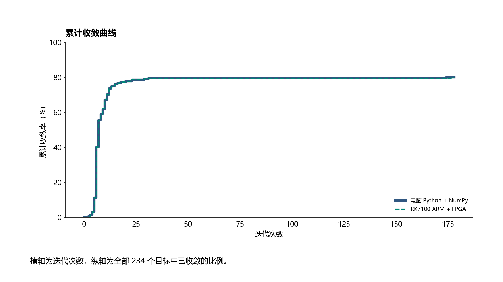
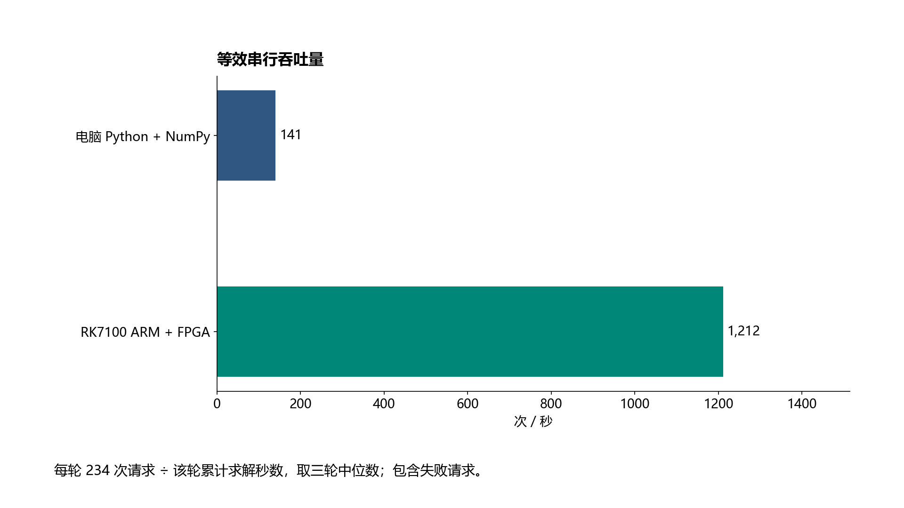
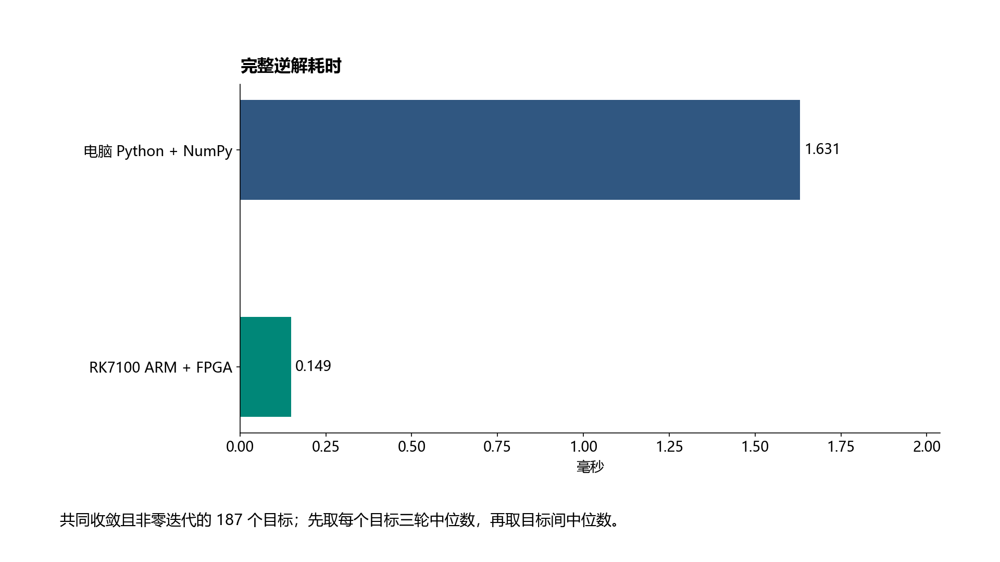

# Zynq7100 SO101 机械臂硬件逆运动学控制系统

本项目用 RK-ZYNQ7100-F 驱动一台 SO101 右臂。操作者通过 Xbox 指定末端位置与腕旋转，板上 ARM 调用 FPGA 逆解核算出五个关节角，再协调五轴运动。夹爪可独立开闭。仓库另提供摄像头手势输入分支。

[项目能力与架构](#项目能力与架构) · [逆解性能对比](#逆解性能对比) · [从零复现](#从零复现) · [视觉手势遥操作](#视觉手势遥操作) · [IP 核接口](#ip核接口) · [参考文献](#参考文献与第三方来源)

## 项目能力与架构

| 能力 | 内容 |
|---|---|
| 末端位置控制 | Xbox 控制 XYZ 平移及 ID5 腕旋转；末端俯仰自由，由肩、肘、腕协同求解 |
| 硬件逆解 | PL 计算雅可比、正规方程和阻尼线性系统，返回单步关节增量；ARM 负责完整迭代和收敛判断 |
| 限位感知求解 | 原 LM 求解未收敛时，使用有限次数的附近初值重试及活动边界约束 |
| 五轴协调执行 | ARM 在线生成具有速度、加速度和加加速度约束的五次 Bézier 轨迹，五轴使用共同规划时长并同步下发中间目标 |
| 独立夹爪 | LT 关闭、RT 开启，同时按下或松开保持开度；夹爪不参与五轴逆解 |
| 状态与异常处理 | 反馈关节角、实际编码器及求解状态；普通拒绝保留有效目标，通信故障冻结新目标，显式停止按既有策略处理 |
| 温控 | PL 风扇 PWM 与片上温度采集，ARM 进行芯片及舵机温度异常判断 |
| 可复现验证 | 提供 HLS 仿真、RTL 协同仿真、数值回归、主机协议及控制逻辑测试 |

XYZ 使用模型基座坐标系，长度单位为米、关节角单位为弧度。位置参考点为模型腕旋转轴端点，**不是夹爪尖端**。

```text
Xbox ──→ Ubuntu：输入处理 / 目标生成 / CSV日志
                      │ UART0，115200 8N1
                      ▼
                ARM 裸机程序
          FK与误差 → 完整迭代 → 终点检查
               │ AXI-Lite        │
               ▼                 ▼
        PL 单步 LM 求解       五轴在线轨迹 + 独立夹爪
               │                 │ UART1，1 Mbps
               └─→ 关节增量      ▼
                           总线适配器 → SO101
```

PL 时钟为125 MHz，包含两个相同求解 IP；单个目标的完整迭代仍由 ARM 管理。双核配置本身不代表生产路径同时并行求解两组目标。

## 逆解性能对比

在相同的 234 个目标上，对比电脑端 Python 3.12.7 + NumPy 1.26.4 与 RK7100 的 Cortex-A9 + FPGA，每个目标重复三轮。两端对所有请求的求解状态判断一致。在共同收敛且需要迭代的目标上，板端完整逆解耗时中位数为 **0.149 ms**，相对电脑端约加速 **11 倍**。计时范围为逆解计算；遥操作响应还包括采样、串口传输和舵机执行。

### 1. 累计收敛率

横轴是允许的迭代次数，纵轴是全部目标中已收敛的比例。两条曲线几乎重合，最终均有 **187 / 234** 个目标收敛（79.9%）。



### 2. 等效串行吞吐量

将每轮全部 234 次请求除以该轮累计求解时间，再取三轮中位数。包含失败请求时，电脑端为 **141 次/秒**，板端为 **1,212 次/秒**。



### 3. 完整逆解耗时

对共同收敛且需要迭代的 187 个目标，先取各目标三轮耗时的中位数，再取目标间中位数。电脑端为 **1.631 ms**，板端为 **0.149 ms**。此处统计一次目标从开始求解到获得关节解所需的完整迭代。



## 从零复现

| 根目录 | 实际内容 |
|---|---|
| [src/](src/) | PS 固件、PL 逆解源码、RTL、硬件配置和依赖源码 |
| [sim/](sim/) | HLS 测试台、回归脚本及历史参考 |
| [build/](build/) | 构建入口、工具配置、校验清单及既有综合实现报告 |
| [board/](board/) | Ubuntu 主机程序、只读核验、基线启动文件和板端实测输出 |
| [data/](data/README.md) | 视频实验输入、配对结果及回归数据 |
| [skill/](skill/) | 工程验证技能包 |
| [report/](report/README.md) | [作品设计报告](report/design_report.docx)、[大模型协作记录](report/llm_collaboration_record.docx)、性能图 |

构建入口按 `build/layout.json` 从上述目录生成工具使用的 `build/work/` 工作副本，保留原有 include、寄存器校验和文件名约定。修改源码时编辑上表中的文件。新运行的日志和报告位于 `build/work/logs/` 和 `build/work/reports/`。归档启动镜像为 `board/boot/boot.bin`，使用该镜像时以 `BOOT.BIN` 为文件名复制到 SD 卡。


以下命令在仓库根目录运行。Windows 推荐路径为 `D:\VivadoProjects\so101_contest`，Ubuntu 示例目录为 `~/rk7100_so101`。Windows 请用无空格短路径，含 `build/work` 的绝对路径长度不得超过 44 个字符。

| 步骤 | 准备或操作 | 文件与调用入口 | 完成判据 |
|---|---|---|---|
| 1. 硬件准备 | RK-ZYNQ7100-F及散热风扇、SO101右臂/ST3215、总线适配器、适配舵机的12V电源、SD卡、DEBUG USB线、Xbox与Ubuntu电脑/虚拟机 | 按下方硬件连接表接线 | 电平、共地、供电及接口方向正确 |
| 2. 安装工具 | Windows安装Vivado/Vitis 2025.2、Zynq-7000器件支持、对应许可证、Python3；补充C回归需要本地GCC | 修改`build/config/toolchain.json`的`amd_root`、`native_gcc` | 工具入口存在且版本匹配 |
| 3. 获取源码 | 将完整工程源码置于上述短路径 | `src/hls/`、`src/ps/`、`src/hardware/`、`src/rtl/`、`src/third_party/`、`build/manifests/` | 保留固定依赖源码及许可证 |
| 4. 完整构建 | 在新的源码副本中执行完整入口；无需已有XPR、BSP或FSBL | `python build/build_all.py` | `build/work/reports/build_status.json`各阶段退出码为0，生成`build/work/board/boot/BOOT.BIN` |
| 5. 补充离线验证 | 检查数值、主机协议、轨迹和温控 | `python build/build_all.py --run verify_software`；`python build/build_all.py --run run_opt_native`；两项RTL仿真脚本见下表 | 对应报告通过；离线通过不替代实物验收 |
| 6. SD启动 | 备份现有启动文件，断电更新SD启动分区根目录的`BOOT.BIN`，选择SD启动后上电 | 使用本次构建的`build/work/board/boot/BOOT.BIN`及`SHA256.json` | 板端串口回复匹配能力标记 |
| 7. Ubuntu准备 | 传入同一版本主机源码，准备独立Python环境和USB设备访问权限 | 安装`build/config/host_requirements_lock.txt`；运行端口和Xbox枚举命令 | 找到实际串口与Xbox事件设备 |
| 8. 只读检查 | 查询身份、芯片温度、风扇和六轴舵机反馈 | `python board/verify_board.py --port /dev/ttyUSB1 --servos --out results/board_readonly.json` | 收到有效反馈；不发送运动或扭矩命令 |
| 9. 求解预览 | 接入Xbox，生成目标并查看板端计算结果 | 下方“预览命令” | 输出目标/求解结果，显示预览且不驱动 |
| 10. 实物控制 | 在实际接线和支撑条件确认后启动 | 下方“运动命令” | Enter启用；五轴和夹爪响应；Ctrl+C返回停止确认 |
| 11. 结果检查 | 比较求解状态、目标与实际计数；归档日志 | `results/*.csv`、`build/work/reports/`、`skill/zynq-so101-validation/` | 区分计算成功、目标接受和物理到达 |

构建顺序为：源码/工具检查 → HLS C仿真 → HLS综合 → RTL协同仿真 → IP打包 → 寄存器检查 → Vivado新建与实现 → 硬件配置检查 → 平台/BSP → ARM/FSBL编译及BOOT打包。构建和离线测试不连接板卡、不启动电机。失败后查看`build/work/logs/`，已有前置产物时可使用 `python build/build_all.py --from-stage hardware` 恢复；阶段恢复不等于一次完整的从零复现。

### 硬件连接

| 接口 | 连接 |
|---|---|
| 电脑↔Zynq调试 | DEBUG USB，UART0：MIO14 RX / MIO15 TX，115200、8N1 |
| Zynq→适配器 | UART1 EMIO，J8第3脚/AK16 TX → 适配器RX |
| 适配器→Zynq | J8第4脚/AJ16 RX ← 适配器TX |
| 共地与电平 | J8第1脚GND共地；UART使用3.3V电平；舵机12V不得接入Zynq信号引脚 |
| 舵机与适配器 | 使用独立12V电源；适配器设为UART通信配置 |
| 风扇 | 板载风扇接入PWM及转速反馈，正常占空比50% |

端口号由设备枚举决定，不保证每次都是`/dev/ttyUSB1`或`/dev/input/event6`。使用VMware时，将Xbox和DEBUG USB交由Ubuntu接管。

### 文件调用指南

| 文件/目录 | 调用方法或职责 |
|---|---|
| `build/config/toolchain.json` | 配置工具安装根目录、器件、8ns周期及本地GCC |
| `build/build_all.py` | 完整构建入口，读取工具配置；首次构建从该入口运行 |
| `build/tools/build_hardware.tcl`、`src/hardware/design_1.tcl` | 由构建入口调用，创建Vivado工程及Block Design |
| `build/tools/build_platform.py`、`build/tools/build_boot.py` | 由构建入口调用，建立平台/BSP并生成配套启动文件 |
| `src/hls/xf_solver_lm_so101.cpp`、`src/hls/lm_solver_so101.hpp` | HLS顶层、单步LM数据通路；由HLS工具编译，不直接用Python运行 |
| `sim/hls/geometry_regression.cpp` | HLS几何与单步求解测试台，由构建入口执行 |
| `src/ps/main.c`、`src/ps/ik_iteration.c` | ARM主程序、硬件调用和完整迭代；随BOOT构建 |
| `src/ps/online_curve.h`、`src/ps/arm_control.c` | 在线轨迹、五轴同步和反馈控制 |
| `src/ps/servo_mapping.h` | 五轴零点、方向、编码器与模型角度范围；更换装配后需独立核验 |
| `board/host/gripper_config.json` | 夹爪闭合/张开端点、开合速率及速度参数 |
| `board/host/xbox_input.py --list` | 在Ubuntu枚举Xbox输入设备：`python board/host/xbox_input.py --list` |
| `board/host/xbox_control.py` | 主控制入口；命令参数示例见下方 |
| `board/verify_board.py` | 板端只读串口检查，需显式指定实际串口 |
| `build/tools/verify_software.py`、`build/tools/run_opt_native.py` | 软件数值、协议与控制回归 |
| `build/tools/run_thermal_sim.ps1`、`build/tools/run_xadc_sim.ps1` | PowerShell执行：`python build/build_all.py --run run_thermal_sim`，另一项使用 --run run_xadc_sim |
| `build/manifests/` | 源码、依赖、接口及兼容性校验依据 |
| `build/work/build/v/ik.xpr` | 构建生成的Vivado工程，可打开查看电路结构 |
| `build/work/build/hardware_export/` | 生成的位流、XSA/HWH、时序、资源及DRC报告 |
| `build/work/board/boot/` | 生成的FSBL、ARM ELF、BOOT.BIN与SHA256清单 |

### Ubuntu启动命令

依赖锁定为pySerial3.5、Linux python-evdev1.9.3；现有主机验证环境使用Python3.14。新环境需安装Python venv组件并具备串口、输入设备访问权限。

```bash
cd ~/rk7100_so101
python3 -m venv ~/venvs/rk7100-so101
source ~/venvs/rk7100-so101/bin/activate
python -m pip install -r build/config/host_requirements_lock.txt
python -m serial.tools.list_ports -v
python board/host/xbox_input.py --list
```

预览命令（不驱动舵机）：

```bash
python -u board/host/xbox_control.py --port /dev/ttyUSB1 --xbox-device /dev/input/event6 --xbox-right-axes rxry --hz 5 --csv results/preview.csv
```

运动命令（会进入实物控制流程）：

```bash
python -u board/host/xbox_control.py --port /dev/ttyUSB1 --xbox-device /dev/input/event6 --xbox-right-axes rxry --test-drive --manual-control --translation-speed 0.05 --hz 10 --gripper-control --gripper-config board/host/gripper_config.json --csv results/drive.csv
```

| 输入 | 动作 |
|---|---|
| 左摇杆↑ / ↓ | X增加 / 减少 |
| 左摇杆← / → | Y增加 / 减少 |
| 右摇杆↑ / ↓ | Z增加 / 减少 |
| 右摇杆← / → | 从爪尖看去，ID5顺时针 / 逆时针 |
| LT / RT | 夹爪关闭 / 开启；同时按下或松开保持开度 |
| Enter / Ctrl+C | 启用控制 / 明确停止，检查板端停止回复 |

目标平移配置上限为0.05m/s；正常五轴速度参数范围为200～2000计数/秒，轨迹加减速阶段的实际速度不等于该寄存器下限。松开摇杆后按既有流程完成最后有效目标并保持扭矩。普通目标拒绝保留上一有效目标并撤销未执行的输入累计；通信异常或心跳超时冻结新目标并保持扭矩。显式停止、程序退出、启动无有效保持目标及舵机温度异常按既有策略处理。

舵机温度超过55℃持续大于1.5秒按既有策略关闭扭矩；芯片超过60℃持续大于1.5秒冻结新控制，降至55℃以下后人工恢复。正常温度不持续输出。模型与实物绝对对齐精度仍需独立验收；完整构建、离线测试和实板验收应分别记录。本目录的完整构建与实板验收不能由`sim/reference/`中的归档报告代替。

## 视觉手势遥操作

仓库另有手势输入分支。摄像头和 MediaPipe Hand Landmarker 在主机上提取单手 21 个关键点，主机将手的运动转换成末端目标。板端握手检查 RK7100、位置加腕旋转逆解等固件标记。Xbox 和视觉是两种上位机入口，使用视觉时只运行一个串口控制程序。[手势分支源码（固定版本）](https://github.com/xiaoGG2333/26FPGAlerobot/tree/0dbaedff3310657b16b7ed6c8b7b16077f2296db/rk7020_so101_hand_teleop_20261102)

| 手部输入 | 控制量 |
|---|---|
| 掌心在画面内左右、上下平移 | 相对标定零位生成 Y、Z 目标 |
| 手部表观长度相对标定值变化 | 估计前后位移，生成 X 目标；单目距离估计会受手的朝向影响 |
| 手部转动 | 按标定配置生成腕旋转 roll；7100 位置控制任务仍允许末端俯仰自由 |
| 伸出五指、握拳 | 分别请求张开、闭合 ID6；实际夹爪使用独立的 GRIP1 方向命令 |

**复现入口。** 在上述分支的视觉子目录准备 OpenCV、MediaPipe、NumPy 和模型文件 `model/data/external/mediapipe/hand_landmarker.task`。先运行 `python sw/pose_map.py --source 0 --no-window --max-frames 60`，在 `results/w3_pose/` 查看姿态日志。这一步只需要摄像头。板端协议见 `sw/pose_link.py`，串口联调入口为 `sw/pose2arm.py`；默认端口 COM18，需按实际设备指定。视觉分支与本地 7100 工程的实物联调需单独验收。

**夹爪保持的已知问题。** 此版本默认映射在伸出 1–4 指或手离开画面时会保留先前夹爪值，后台还会重发最近的开闭方向。因此从握拳切换到中性手势后，夹爪可能继续闭合。实物联调前应先验证中性、丢手和视频停帧均会撤销旧方向，可先用 `--no-grip` 单独检查五轴。

## IP核接口

### 总线与任务

顶层为 `xf_solver_lm_so101`，使用32位AXI4-Lite寄存器接口，时钟125MHz。CORE0基地址`0x40000000`，CORE1基地址`0x40010000`。以下偏移均相对选定核的基地址，清单以[`build/manifests/registers_baseline.json`](build/manifests/registers_baseline.json)及本次HLS生成驱动头文件为准。

IP完成一步阻尼最小二乘求解：

```text
A = JᵀJ + |lambda| I
b = Jᵀe
A delta_q = b
```

输入`sin(q)`、`cos(q)`和误差，输出`delta_q`；IP不直接接收舵机计数或生成PWM，也不自行执行完整迭代。浮点字段采用IEEE754 float32的原始位模式，不能将浮点数做整数数值转换后写入。

| 寄存器 | 偏移 | 类型/方向 | 含义 |
|---|---|---|---|
| AP_CTRL | `0x00` | 控制/状态 | bit0启动，bit1完成，bit2空闲，bit3就绪，bit7自动重启；完成位读后清除 |
| GIE / IER / ISR | `0x04 / 0x08 / 0x0C` | 中断控制 | HLS标准中断寄存器；当前ARM使用有界轮询 |
| sin0…sin4 | `0x10, 0x18, 0x20, 0x28, 0x30` | float32输入 | 五个关节角的正弦 |
| cos0…cos4 | `0x38, 0x40, 0x48, 0x50, 0x58` | float32输入 | 五个关节角的余弦 |
| e0…e5 | `0x60, 0x68, 0x70, 0x78, 0x80, 0x88` | float32输入 | 任务误差及位置任务的保留字段，见下表 |
| lambda | `0x90` | float32输入 | 阻尼与任务选择 |
| d0…d4 | `0x98, 0xA8, 0xB8, 0xC8, 0xD8` | float32输出 | 五轴单步增量，单位rad，不是最终关节角 |
| d0…d4有效控制 | `0x9C, 0xAC, 0xBC, 0xCC, 0xDC` | 输出控制 | bit0为对应输出有效标记 |
| status / status控制 | `0xE8 / 0xEC` | int32输出/控制 | 0为单步成功，1为失败；不表示完整IK已收敛 |
| state输入 | `0xF8` | int32输入 | 顶层状态指针的输入侧，ARM调用前清零 |
| state输出 / 控制 | `0x100 / 0x104` | int32输出/控制 | 应用状态bit0 ready、bit1 done、bit2 busy；运行完成仍以AP_CTRL为准 |

输入寄存器间隔不是全部连续4字节，输出还包含控制字段，不能按连续数组直接假设偏移。源码旧注释中的state地址不作为接口依据。

| 任务 | lambda | e字段约定 |
|---|---|---|
| 六维误差任务 | 正值 | e0…e2为位置误差，e3…e5为旋转误差 |
| XYZ+ID5任务 | 负值，绝对值为实际阻尼 | e0…e2为位置误差；e3为ID5关节角误差；e4为0；e5以float数值0…15表示ID1…ID4活动约束位掩码，通常为0 |

位置任务中，掩码为1的相应雅可比列被约束；ARM按迭代状态决定何时使用并重新判断。ID5直接角度任务不等于固定完整末端姿态。任务选择与掩码属于现有PS/PL协议，不能混用字段语义不同的固件和位流。

调用顺序：等待AP_CTRL空闲 → 写入全部输入并清state输入 → 写AP_CTRL启动（不启用自动重启）→ 有超时地轮询ap_done → 检查status → 读取五个增量 → ARM进行数值、试步和收敛检查。当前轮询同时限制次数和时间；不能无限等待。上层完整IK状态与IP单步status分别处理。

## 轨迹与逆解实现说明

轨迹参考Ruckig的在线状态更新、多轴同步及速度/加速度/加加速度约束思路，实际实现为[`src/ps/online_curve.h`](src/ps/online_curve.h)中的五次Bézier轨迹和公共时长搜索，使用Bernstein导数界检查连续轨迹。**本项目未直接集成Ruckig库，不宣称实现其时间最优算法。**

逆解采用LM阻尼正规方程与Cholesky求解。ARM负责FK误差、阻尼试步验收、关节边界和有限初值重试；PL通过固定尺寸矩阵结构、数组分区与展开承担单步数值运算。125MHz与硬件结构是否带来整体提速，须在相同输入、精度和停止条件下对照测量；不引用上游加速倍数作为本工程实测结果。

## 参考文献与第三方来源

以下包括算法文献、代码来源、工具文档与硬件资料。版权、许可证及已有来源说明继续随源码保留。

1. E1pco. [Hardware-Accelerated System for IK Solution Based on LeRobot](https://github.com/E1pco/Hardware-Accelerated_System_for_IK_Solution_Based_on_LeRobot).
2. AMD/Xilinx. [Vitis Libraries](https://github.com/Xilinx/Vitis_Libraries); [Vitis Solver Library 2024.2](https://docs.amd.com/r/2024.2-English/Vitis_Libraries/solver/benchmark.html_2). 本地许可：[src/third_party/license.txt](src/third_party/license.txt)。
3. Sugihara, T. [Solvability-Unconcerned Inverse Kinematics by the Levenberg–Marquardt Method](https://ieeexplore.ieee.org/abstract/document/5784347/). IEEE Transactions on Robotics, 2011. DOI: 10.1109/TRO.2011.2148230.
4. Marquardt, D. W. [An Algorithm for Least-Squares Estimation of Nonlinear Parameters](https://epubs.siam.org/doi/10.1137/0111030). Journal of the Society for Industrial and Applied Mathematics, 1963, 11(2): 431–441.
5. Berscheid, L.; Kröger, T. [Jerk-limited Real-time Trajectory Generation with Arbitrary Target States](https://arxiv.org/abs/2105.04830). Robotics: Science and Systems, 2021.
6. Berscheid, L.等. [Ruckig: Motion Generation for Robots and Machines](https://github.com/pantor/ruckig).
7. AMD. [Vitis High-Level Synthesis User Guide (UG1399), 2025.2](https://docs.amd.com/r/2025.2-English/ug1399-vitis-hls).
8. AMD. [7 Series FPGAs and Zynq-7000 SoC XADC User Guide (UG480)](https://docs.amd.com/r/en-US/ug480_7Series_XADC/Instantiating-the-XADC).
9. JoyandAI. [LeRobot auto_calibrate.py](https://github.com/JoyandAI/lerobot/blob/072e8355fbb9a7b520915d44877aa876794efb31/src/lerobot/motors/auto_calibrate.py), commit `072e8355fbb9a7b520915d44877aa876794efb31`. [本地来源说明](board/host/vendor_calibration_provenance.md)、[Apache-2.0许可](board/host/vendor_calibration_license.txt)。
10. Box2AI Robotics. [joycon-robotics](https://github.com/box2ai-robotics/joycon-robotics).
11. pySerial贡献者. [pySerial Documentation](https://pyserial.readthedocs.io/en/latest/).
12. python-evdev贡献者. [python-evdev Documentation](https://python-evdev.readthedocs.io/en/latest/).
13. RK-ZYNQ7100-F厂商. 《ZYNQ7100-F V1.0原理图》《ZYNQ7100-F V1.0管脚定义》.
14. 微雪. 《Bus Servo Adapter (A) v1.1 使用说明书》.
15. 机械臂供应方. SO101 follower R12254604编码器标定参数.
